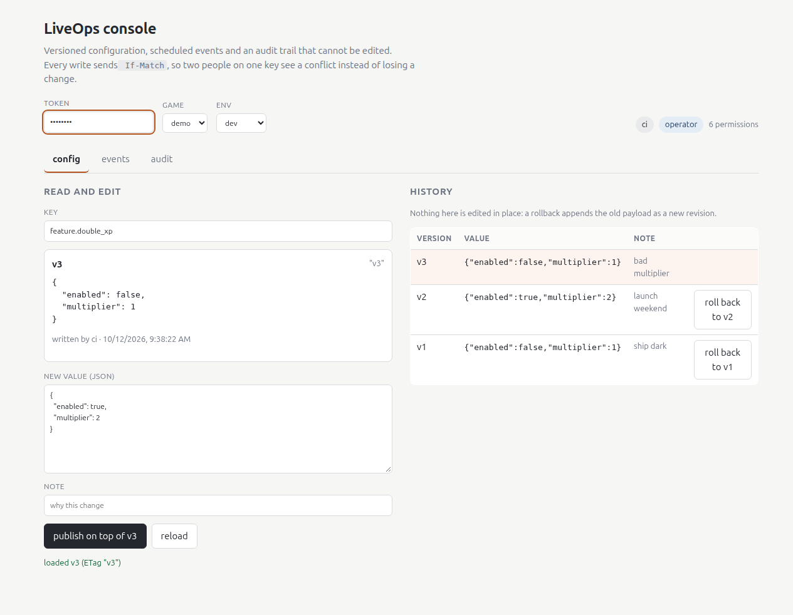
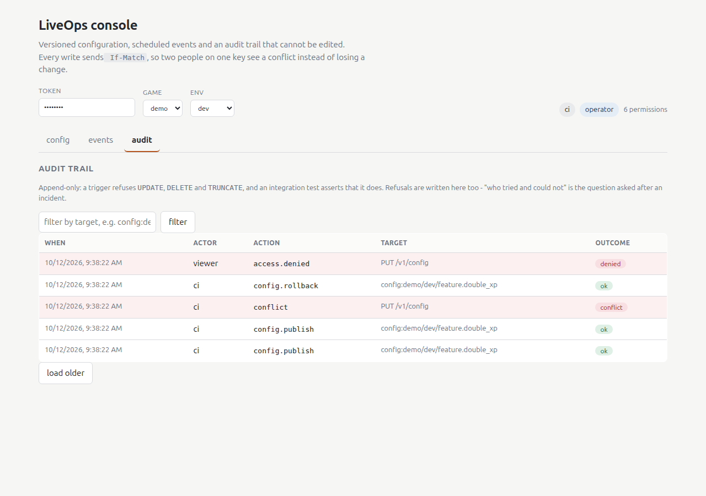

# liveops-console

[](https://github.com/lasttoss/liveops-console/actions/workflows/ci.yml)

A LiveOps control plane for a live game: versioned remote configuration with rollback, an
audit trail that cannot be edited, and scheduled rewards that happen exactly once. Go,
PostgreSQL, and a TypeScript panel that talks to the same public API everything else uses.

Everything quoted in this file was printed by `make demo` on a fresh clone.

```
make demo        # compose up from empty: the story, the worker twice, then the counters
make test-db     # start PostgreSQL, run every test including the integration ones
make panel       # the panel container; paste op-token, then press publish on top of v1
make worker      # one worker pass, on its own - run it twice and watch the second say zero
```

## What this demonstrates

| capability | how it is done here | where |
|---|---|---|
| **configuration as a log** | every publish is an append; a rollback copies an old payload into a new revision, so history is never rewritten | `internal/pgstore/pgstore.go`, `migrations/0001_schema.sql` |
| **concurrency you can see** | `If-Match: "v17"` on writes, serialised per key with `pg_advisory_xact_lock`; the loser gets `409` **carrying the version that won** | `handleConfigPut`, `TestStaleExpectVersionIsAConflict` |
| **exactly-once, by primary key** | the schedule is materialised on create, and the worker's claim *is* the effect: one `UPDATE ... FOR UPDATE SKIP LOCKED` | `ClaimDue`, `TestWorkerProducesOneEffectEvenUnderConcurrency` |
| **an audit trail, not a log** | a trigger refuses `UPDATE`, `DELETE` and `TRUNCATE`; an integration test asserts the refusal is real | `migrations/0002_audit_append_only.sql`, `TestAuditTrailCannotBeEdited` |
| **authorisation with an environment rule** | roles in code, actors from tokens, and production *writes* require `admin` while production *reads* do not | `internal/auth`, `TestProductionWritesNeedAnAdmin` |
| **a refusal is a first-class outcome** | every `403` and every conflict is written to the same trail as the successes, with the reason | `internal/api.authorize`, the trail in the demo output below |
| **the panel is a client, not a console** | React + TypeScript, `If-Match` on every write, a conflict banner that offers the winner's value as the new base | `panel/src/`, `panel/src/api.ts` |

## The demo, as it prints

```
liveops-console - a change you can undo, and a reward that happens once

1. who am I
   {"actor": "ci", "role": "operator", "permissions": ["audit:read", "config:publish", ...]}

2. publish a flag: config is append-only, so this is revision 1
   PUT /v1/config -> 200  ETag: "v1"
3. a client that already holds v1 asks again
   GET with If-None-Match -> 304 (no body sent)

4. turn it on, on top of the version we read
   PUT /v1/config with If-Match: "v1" -> 200  ETag: "v2"

5. a second editor still holds v1 and writes anyway
   PUT /v1/config with a stale If-Match -> 409 (the loser is told which version won)
   {"current_version": 2, "error": "version conflict: the current version is 2"}

6. roll back to v1: history is kept, a new revision is appended
   POST /v1/config/rollback -> 200  ETag: "v3"

8. a viewer tries to publish
   PUT /v1/config as viewer -> 403
9. prod is guarded by role, not by convention
   PUT /v1/config as operator in prod -> 403
   {"error": "config:publish in \"prod\" requires role \"admin\", not \"operator\""}

claimed 1 fire (worker ae1d26fefa0d) - effect recorded once
claimed 0 fires (worker a3580f6b17ce) - nothing was pending

10. counters after the workers ran
   liveops_config_revisions_total 3
   liveops_config_keys 1
   liveops_events 1
   liveops_event_fires_pending 0
   liveops_event_effects_total 1
   liveops_audit_rows_total 8
   liveops_access_denials_total 2

11. the audit trail: successes and refusals in the same table, newest first
   ae1d26fefa0d event.fire         event:1                          ok
   ci           access.denied      PUT /v1/config                   denied
   viewer       access.denied      PUT /v1/config                   denied
   ci           event.create       event:1                          ok
   ci           config.rollback    config:demo/dev/feature.double_xp ok
   ci           conflict           PUT /v1/config                   conflict
   ci           config.publish     config:demo/dev/feature.double_xp ok

12. exactly-once, visibly
   two worker passes, one fire, effects = 1
   the second pass found nothing pending: the claim and the effect are the same UPDATE
```

The two worker lines are the point. They are printed by the same binary with
`--mode worker --once`, run twice, and the second pass is a no-op because the row it would
have claimed is no longer `pending`. The CI job greps for both lines, so the claim cannot
quietly become false.

## The panel



The panel is served from the same origin as the API (`panel/nginx.conf` proxies `/v1`), so
there is no CORS configuration to get wrong and the token stays in the browser that typed
it. Reads go through the same endpoint the demo client uses; every write sends `If-Match`.

It is also the reason one bug in this repository is worth mentioning: the unit tests all
passed while the panel could not make a single request. `fetch` was being called through
the client object - `this.fetchImpl(...)` - and the browser answered *"Illegal invocation"*.
A fake fetch cannot see that, because a fake does not check its receiver. There is now a
test that installs a real `globalThis.fetch` and drives the default constructor path, and
the fix is commented where it happened (`panel/src/api.ts`). Screenshots and a passing
test suite are not the same thing as a page that works.

The audit view is the other half of the argument:



## How it works

**Figure 1.** A read is one row lookup and a version in an `ETag`; a write takes a per-key
advisory lock, appends a revision, and records who did it. The worker has no queue in front
of it: the due rows are the queue, and the claim and the effect are the same statement.


The figure is generated from a committed script
(`docs/figures/liveops-console-architecture.generator.py`), because a diagram that is only
an image goes stale the first time the code moves. Its `diagram-meta` names the source
files, and `make diagram` fails when the export is older than them. The first version of
the figure was laid out by eye and the export came back with the API's command lines
printed across the database column - which is why the generator now measures its own text
before placing a box.

```
panel ──/v1──▶ api ──┬──▶ postgres:  config_revisions · events · event_fires · audit_log
(React)              ├──▶ /metrics  (hand-rendered exposition, no client library)
                     └──▶ audit_log: every write AND every refusal
worker (same binary) ──▶ claims due fires, records the effect in the same transaction
```

## Numbers

- **41 Go test functions** across 9 packages (7 under `internal/`, plus both `cmd/` binaries)
  and **11 panel tests**; `go test -race` on every push, with the integration tests running
  against a real PostgreSQL in CI.
- **55.7% statement coverage** (`make test-db`, which starts a throwaway PostgreSQL). `make
  coverage` alone prints **34.6%**: without `LIVEOPS_TEST_DSN` the store's tests skip, and the
  difference between the two numbers is the part of the service a database is needed to
  reach. The number is printed rather than targeted: the two `cmd/` packages are clients,
  and their behaviour is the `demo` CI job which greps their output. Every *promise* in the
  table above is asserted - versions, conflicts, one effect under four concurrent workers,
  an uneditable trail.
- **~1,900 lines of Go and ~800 of TypeScript**, against **~1,200 lines of tests**.
- The demo is **12 steps, no setup**: `docker compose up` plus three `docker run` calls.

## What this does not claim

- **Not multi-tenant.** One database, one deployment, no isolation story between games.
- **Not a client SDK.** `cmd/demo` is a Go HTTP client, not something a game engine links.
- **The effect is local.** Exactly-once holds for the fire row. If the effect were an HTTP
  call to another system, that system would need its own idempotency key - the trade is
  written down in `docs/design-notes.md`, not hidden.
- **`DROP TABLE` is still allowed** by the role that owns the schema. The trigger stops
  edits, not removal; a larger deployment separates the migrating role from the running one
  and revokes `DROP`. Said plainly because implying otherwise would be worse.
- **The panel is a control panel, not a design showcase.** It exists to prove the API is
  usable from TypeScript, and it does.

## Repository standard

| item | here | note |
|---|---|---|
| `docker-compose.yml` | ✅ | postgres + api + panel; the demo client and the worker are one-off `docker run`s so `compose up` cannot start a second API by accident |
| `Dockerfile` | ✅ | two stages, distroless `static-debian12:nonroot`; migrations are embedded in the binary because the final image has no shell |
| Helm chart | ✅ | `charts/liveops-console` - `helm lint --strict`, both value branches rendered, then `kubeconform` |
| `docs/figures/` + freshness gate | ✅ | `liveops-console-architecture` with `diagram-meta`; `make diagram` fails on a stale export |
| tests + coverage in CI | ✅ | unit tests without a database, integration tests with one, coverage printed on every run |
| README with what it demonstrates | ✅ | this file |

## Licence

MIT. See `LICENSE`. Provenance - what was carried over and what was not - is in
`PROVENANCE.md`.
