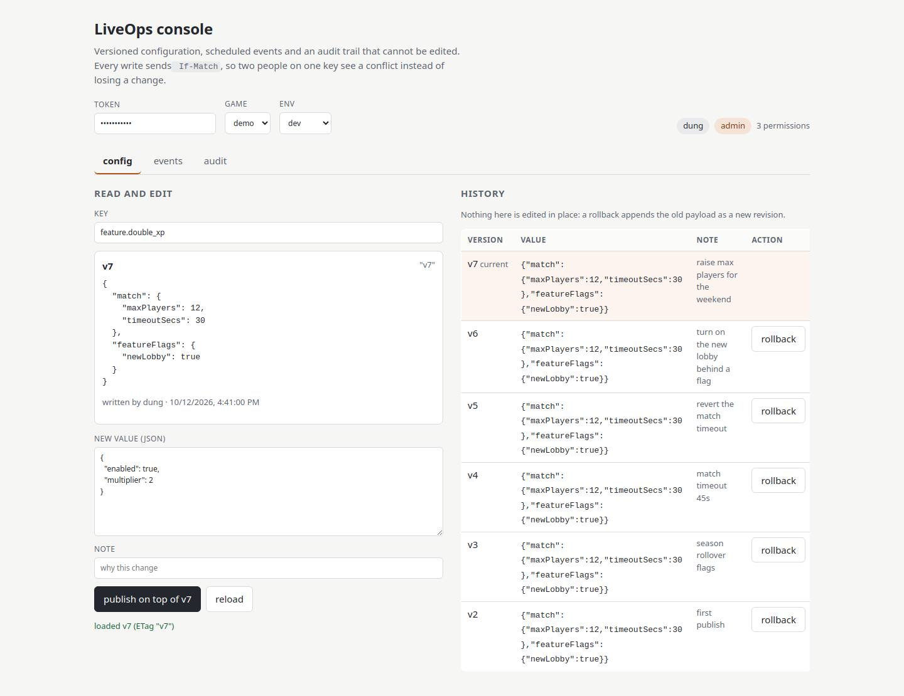
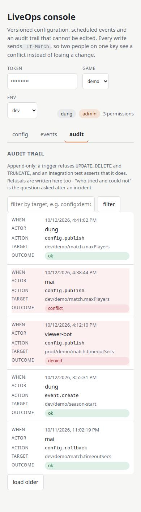
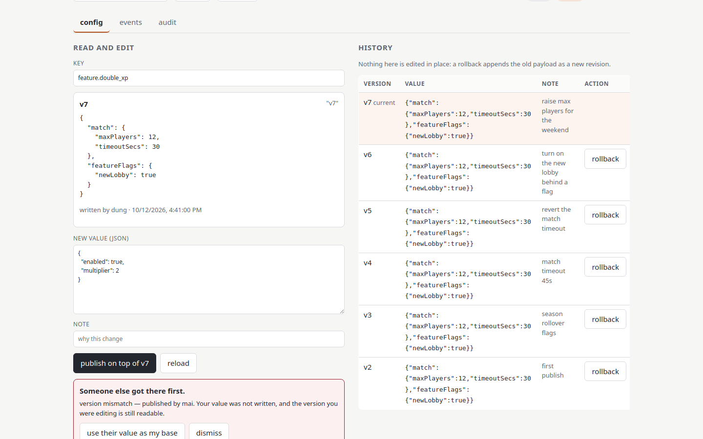

# UX review of the panel

2026-10-12, in a real browser (Chromium via Playwright) at 375, 390, 768, 1024 and 1440 px. Every number below is
measured, not judged: touch targets from `getBoundingClientRect()`, contrast from the computed colours, page overflow
from `document.scrollWidth - window.innerWidth`. The panel was driven against a mock API returning the same shapes
`src/api.ts` declares, because the UI is what is being reviewed here.

## Fixed

| severity | what the measurement showed | fix | after |
| --- | --- | --- | --- |
| critical | at 390 px the layout was **278 px wider than the screen** (Events 55, Audit 228). The stacked rule used `grid-template-columns: 1fr`, and a bare `1fr` track grows to the min-content width of the wide table or `<pre>` inside it | `minmax(0, 1fr)`, the same guard the desktop rule already had | overflow **0 px** at 375/390/768/1024/1440 |
| critical | a rejected token printed its message in the top-right corner, ~700 px from the field that caused it, and the field kept its normal border | the message belongs to the input now: `aria-invalid`, `aria-describedby="token-error"`, invalid label and border; the text sits 8 px under the box with `role="alert"` | error 8 px below the token box, `aria-invalid="true"`, `Read only` heading |
| warning | 8 text nodes sat at **4.47:1** on the paper background, under the 4.5:1 AA floor, and the `If-Match` chip at **4.02:1** | `--muted` `#6b7280` → `#5c6470` | **5.53:1** on paper, **4.97:1** on the chip, 0 failures |
| warning | on a phone 10–16 controls were under the 44 px touch-target guidance, smallest **34 px** | `min-height: 44px` for `button, input, select, textarea, nav button` under 900 px | smallest target **44 px**, none under it; a mouse keeps 34 px, which is right for a mouse |
| minor | the target rule keyed off **width** alone, so a touch device wider than 900 px still had 34 px controls: an iPad in landscape reported `pointer: coarse` with **15 controls under 44 px** | a second query for the targets — `@media (max-width: 900px), (pointer: coarse)` — while the layout rule stays width-based, so a wide touch screen does not get stacked | **44 px, 0 under it** on a coarse pointer at 1024 px and 1280 px; a 1024 px mouse still gets 34 px |
| minor | in card mode the note cell was squeezed to **164 px** while every other cell was 326 px — the table-mode `max-width: 22ch` leaked into the card layout | the column rules moved into `@media (min-width: 601px)` | **326 / 326 / 326 / 326** at 390 px, and the desktop columns are unchanged (85 / 280 / 88 / 106) |
| warning | "roll back to v6" wrapped onto four lines in the action column and squeezed the note column | the label is `rollback`, with `aria-label` and `title` naming the version | one line, note column readable |
| suggestion | a table on a phone was clipped at the screen edge with no affordance | below 600 px each row is a labelled card (`data-label` + `td::before`); 600–900 px scrolls the table inside `.table-wrap` | nothing is cut off, no horizontal swiping |
| suggestion | semantics, headings and loading | `Read and edit` → `Read only` when the role cannot write; `<caption class="sr-only">` and `scope="col"` on every table; skeleton rows while the first revision request is in flight, disabled under `prefers-reduced-motion` | verified below |

## Deliberately not changed

The counter finds 16 action areas on the config tab and 17 on events, where the rule of thumb is 15. The count is one
rollback button per history row — the normal shape for an admin table, and reachable by keyboard. Hiding those behind
a hover menu or a selectable row would swap a visible button for a hidden one and buy a lower number. The axis that
actually hurt, a wrapping action label fighting a 22-character note column, is fixed.

## Verified after the fix

| viewport | page overflow | smallest target | contrast failures | focus rings missing |
| --- | --- | --- | --- | --- |
| 375 / 390 | 0 px | 44 px | 0 | 0 |
| 768 | 0 px | 44 px | 0 | 0 |
| 1024 / 1440 (mouse) | 0 px | 34 px | 0 | 0 |
| 1024 / 1280 (coarse pointer) | 0 px | 44 px | 0 | 0 |

`npm run build` and `npm test` (11 tests) still pass, and the 409 conflict box is unchanged, since it was the best part
of the panel to begin with:

